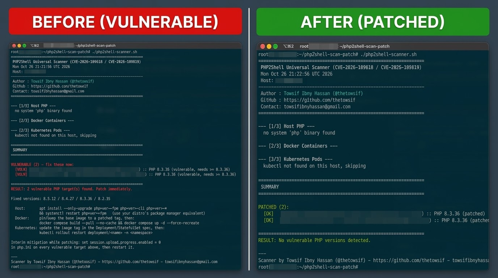

# PHP2Shell Scanner & Remediation Toolkit

Universal scanner and automated patching playbook for **CVE-2026-109618** and **CVE-2026-109619** ("PHP2Shell").

This repository provides:
1. **`php2shell-scanner.sh`**: A shell scanner detecting vulnerable PHP runtimes across host systems, Docker containers, and Kubernetes pods.
2. **`php2shell-patch-prompt.md`**: An audit-and-patch prompt for AI coding agents (Antigravity, Cursor, Claude Code, GitHub Copilot) to safely inspect and patch codebases.
3. **Verification Proof (`patch.png`)**: Visual proof of a clean scan run verifying all targets are fully patched.

---

## Proof of Clean Verification

The scanner was executed in production to verify remediation. All detected PHP runtimes passed verification with zero vulnerabilities:



---

## Vulnerability Summary

| Item | Details |
| :--- | :--- |
| **CVE Identifiers** | CVE-2026-109618, CVE-2026-109619 |
| **Common Name** | PHP2Shell |
| **Severity** | Critical (CVSS 9.2) |
| **Vulnerable Scope** | PHP 5.4.0 through 8.5.11 |
| **Patched Versions** | **8.5.12**, **8.4.27**, **8.3.36**, **8.2.35** |
| **End of Life (EOL)** | PHP 8.1 and older (no official patch; upgrade to 8.2.35+ required) |

---

## Scanner Features

- **Host Inspection**: Checks native CLI `php` and all discovered `php-fpm` binaries (`/usr/bin`, `/usr/sbin`, `/usr/local/bin`, `/usr/local/sbin`).
- **Docker Container Inspection**: Discovers running containers via `docker ps` and verifies runtime versions using `docker exec`.
- **Kubernetes Inspection**: Inspects all pods and containers across all accessible namespaces via `kubectl exec`.
- **Deduplication**: Handles duplicate binary paths and skips non-PHP containers automatically.
- **CI/CD Ready**: Exits with code `0` on clean targets and code `1` when any vulnerable instance is found.

---

## How to Run the Scanner

### Prerequisites

- **Host Scans**: Bash shell with root or `sudo` privileges.
- **Docker Scans**: Docker CLI with permissions to communicate with the Docker daemon.
- **Kubernetes Scans**: Configured `kubectl` context with cluster execution permissions.

### Quick Start

1. **Clone the repository**:
   ```bash
   git clone https://github.com/thetowsif/php2shell-scan-patch.git
   cd php2shell-scan-patch
   ```

2. **Make the scanner executable**:
   ```bash
   chmod +x php2shell-scanner.sh
   ```

3. **Execute the scan**:
   ```bash
   sudo ./php2shell-scanner.sh
   ```

### Exit Codes

- `0`: Clean. All identified PHP targets are patched.
- `1`: Vulnerable target(s) detected or unsupported EOL PHP versions found.

---

## Remediation Guide

### 1. Host Runtimes (Debian / Ubuntu)

Upgrade version-suffixed packages to prevent unexpected major upgrades:

```bash
sudo apt update
sudo apt install --only-upgrade php8.3-fpm php8.3-cli php8.3-common php8.3-*
sudo systemctl restart php8.3-fpm
```

*(Replace `8.3` with your installed release branch: `8.2`, `8.4`, or `8.5`)*

### 2. Docker Containers

1. Update the `Dockerfile` base image tag to a patched release (e.g. `php:8.3.36-fpm` instead of unpinned `php:8.3-fpm`).
2. Rebuild without cache and restart containers:
   ```bash
   docker compose build --pull --no-cache
   docker compose up -d --force-recreate
   ```

### 3. Kubernetes Pods

1. Update the image reference tag in your Deployment or StatefulSet YAML.
2. Trigger a rollout restart:
   ```bash
   kubectl rollout restart deployment/<deployment-name> -n <namespace>
   ```

### 4. Interim Mitigation

If patching cannot be deployed immediately, disable upload progress tracking in `php.ini` to neutralize exploitation:

```ini
session.upload_progress.enabled = 0
```

Restart PHP-FPM or Apache/Nginx web server workers afterward.

---

## Using the AI Agent Patch Prompt

The repository includes [`php2shell-patch-prompt.md`](php2shell-patch-prompt.md), an end-to-end prompt optimized for AI coding agents:

1. **Phase 1 (Investigate)**: Inventories runtimes, base images, build pipelines, and caching layers without altering files.
2. **Phase 2 (Apply)**: Implements precise upgrades across container specifications and host package managers upon approval.

### Steps to Use

1. Open [`php2shell-patch-prompt.md`](php2shell-patch-prompt.md).
2. Fill in the placeholder project details (`[PROJECT NAME]`, deployment targets).
3. Paste into your AI coding assistant (Antigravity, Cursor, Claude Code, or Copilot).

---

## Author & Contact

- **Author**: Towsif Ibny Hassan ([@thetowsif](https://github.com/thetowsif))
- **GitHub**: [github.com/thetowsif](https://github.com/thetowsif)
- **Contact**: [towsifibnyhassan@gmail.com](mailto:towsifibnyhassan@gmail.com)
